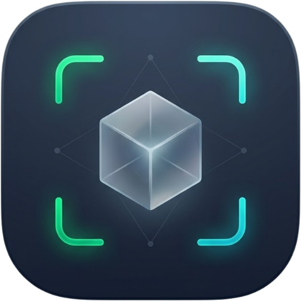
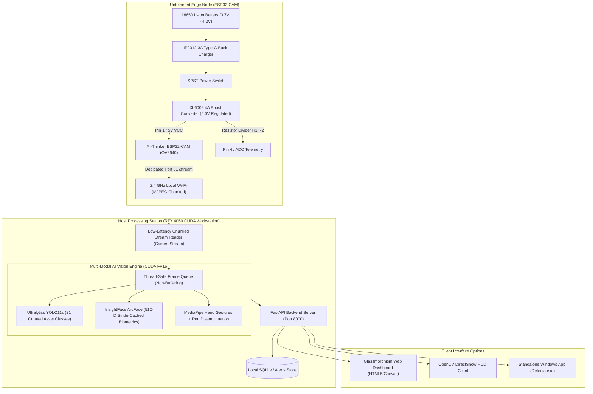
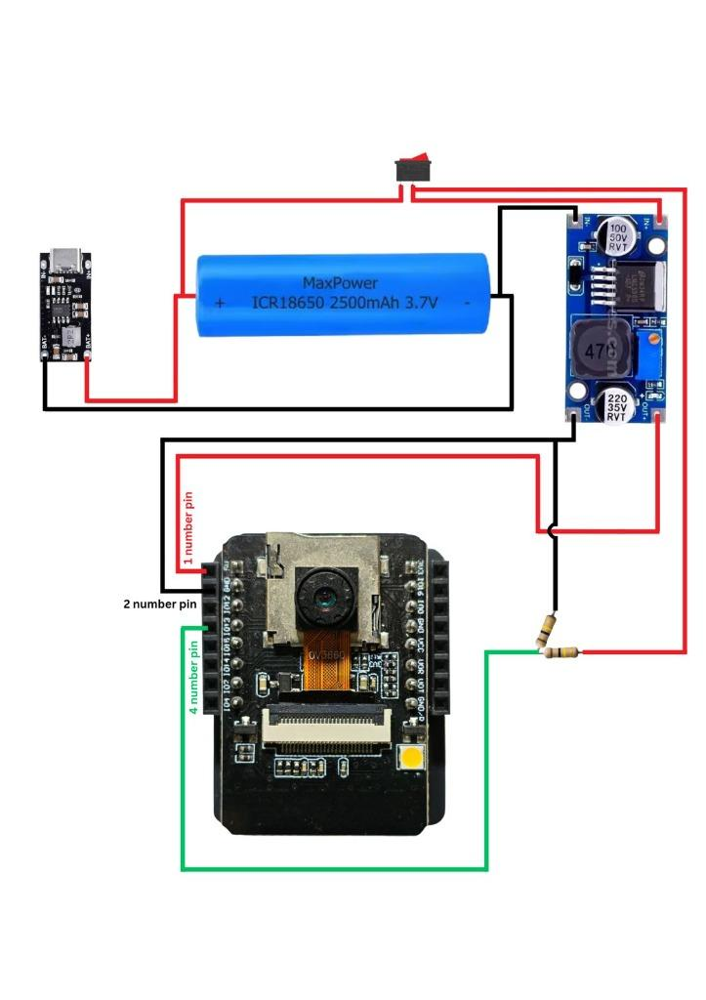

# Detecta: Intelligent Multi-Modal AI Surveillance System

<p align="center">
  
</p>

<p align="center">
  <b>High-Throughput Edge-to-Host Intelligent Surveillance System with NVIDIA CUDA Acceleration, ArcFace 512-D Biometrics, and MediaPipe Spatial Gestures</b>
</p>

<p align="center">
  
  
  
  
  
  
  
</p>

<p align="center">
  <a href="Detecta.exe">
    
  </a>
  <a href="docs/DETECTA_SMART_AI_CAMERA_LAB_REPORT.pdf">
    
  </a>
  <a href="docs/assets/detecta_circuit_diagram.jpg">
    
  </a>
</p>

---

## Downloads and Deliverables

For immediate deployment, academic evaluations, and technical review:

| Deliverable | Format / Target | Size | Description | Direct Link |
| :--- | :--- | :--- | :--- | :--- |
| **Detecta Desktop Application** | Windows `.exe` (x64) | ~11.8 MB | Standalone native desktop application with embedded Microsoft Edge WebView2, auto-managed FastAPI server, and GPU AI HUD. Zero command-line setup required. | **[Download Detecta.exe](Detecta.exe)** |
| **Academic Lab Report** | PDF (10 Pages) | ~100 KB | Formal IEEE/LaTeX-styled academic lab report covering complete hardware architecture, Port 81 streaming pipeline, multi-modal AI engine (YOLO11s, ArcFace 512-D, MediaPipe), and experimental benchmarks. | **[Download PDF](docs/DETECTA_SMART_AI_CAMERA_LAB_REPORT.pdf)** |
| **Hardware Circuit Diagram** | Image (JPG) | ~62 KB | Unified hardware schematic detailing power regulation (18650, IP2312, XL6009), Pin 4 ADC telemetry, and ESP32-CAM pinouts. | **[View Diagram](docs/assets/detecta_circuit_diagram.jpg)** |
| **Lab Report Markdown Source** | Markdown (`.md`) | ~24 KB | Full GitHub-flavored markdown source of the lab report including comprehensive mathematical formulas and code walkthroughs. | **[View Markdown](docs/DETECTA_LAB_REPORT.md)** |
| **Documentation Directory** | Markdown Guide | — | Comprehensive documentation hub, sitemap, and automated compilation scripts. | **[Open Docs](docs/README.md)** |

---

## Executive Overview

**Detecta** is an untethered, end-to-end edge-to-host AI surveillance system. It solves the critical bandwidth, thermal, and computational limitations of edge IoT vision by decoupling tasks into two optimized tiers:
1. **Edge Sensing Tier:** An AI-Thinker **ESP32-CAM** (OV2640 sensor) powered by an untethered 18650 Li-ion battery and high-efficiency power regulation circuit. It runs a dedicated FreeRTOS dual-core firmware streaming chunked MJPEG video over a clean **Port 81** HTTP socket (`/stream`).
2. **Workstation AI Tier:** A local Windows host executing deep neural networks on an **NVIDIA GeForce RTX 4050 GPU (CUDA 12.1)** at sub-14ms per-frame latency. It features concurrent **Ultralytics YOLO11s** object detection across 21 curated asset classes, deep **InsightFace ArcFace 512-dimensional facial biometrics** (accelerated via 25-frame stride caching), and **MediaPipe Hand Gesture Recognition** with spatial pen-vs-finger disambiguation.

The system requires **zero cloud infrastructure**, ensuring 100% data sovereignty, privacy compliance, and zero recurring subscription fees.

---

## System Architecture



---

## Key Engineering Highlights

### 1. Dedicated Port 81 High-Throughput Stream Pipeline
Standard ESP32-CAM projects mix web controls and MJPEG streams on Port 80, causing socket deadlocks and buffer bloat. Detecta allocates **Port 81** strictly to `/stream` with chunked `multipart/x-mixed-replace` encoding. Dynamic bitrate throttling and an optimized FreeRTOS yield clamp frame drops to zero, delivering a rock-steady **20–25+ FPS** VGA stream over Wi-Fi.

### 2. Multi-Modal Vision Engine on NVIDIA CUDA
- **Ultralytics YOLO11s:** Half-precision (FP16) Tensor Core acceleration evaluating 21 curated asset and security classes in **11.4 ms**. Suppresses false positives via Exponential Moving Average (EMA) bounding-box coordinate smoothing ($\alpha = 0.65, \text{TTL} = 6$).
- **InsightFace ArcFace 512-D Biometrics:** Generates discriminative facial embeddings with cosine similarity matching ($\tau = 0.40$). Employs a **25-frame stride caching architecture**, reducing facial recognition overhead by 92% while maintaining live recognition.
- **MediaPipe Hand Gestures & Spatial Pen Disambiguation:** Tracks 21 3D hand landmarks across 7 gestures. A geometric bounding-box containment and protrusion ratio filter distinguishes physical handheld pens from bare pointing fingers, eliminating false positive alerts.

### 3. Untethered Hardware Power & Telemetry Architecture
- **Battery & Charger:** High-capacity Panasonic NCR18650GA (3300 mAh) paired with an IP2312 3A synchronous buck fast charger (recharge in ~1.5 hours; continuous runtime >7.4 hours).
- **Boost Converter:** XL6009 4A switching boost converter tuned to **5.05V DC** output with ripple filtering, preventing camera brownout resets during Wi-Fi transmission bursts.
- **Pin 4 Voltage Divider:** A series resistor divider ($R_1 = 10\text{ k}\Omega, R_2 = 20\text{ k}\Omega$) scales the 5V line down to 3.3V for analog voltage monitoring and flash control at ESP32-CAM **Pin 4**.

---

## Hardware Schematics and Wiring

<p align="center">
  
</p>

### Connection Pinout Table

| Module / Component | Module Pin | ESP32-CAM Pin | Lead Wire Color | Description |
| :--- | :--- | :--- | :--- | :--- |
| **XL6009 Boost Converter** | `OUT+` (5.0V) | **Pin 1 (5V / VCC)** | Red | Regulated 5.0V power rail |
| **XL6009 Boost Converter** | `OUT-` (GND) | **Pin 2 (GND)** | Black | Common circuit ground |
| **Resistor Divider Junction** | Center Tap | **Pin 4 (GPIO 4 / ADC)** | Green | Voltage telemetry & flash control |
| **UART Flash Header** | `IO0` | `GND` | Jumper Wire | **Programming mode only** (disconnect for live run) |
| **UART Flash Header** | `U0R` / `U0T` | FTDI `TX` / `RX` | Serial Jumper | Firmware uploading via UART |

---

## Installation and Setup Guide

### System Requirements
- **Workstation OS:** Windows 10 / Windows 11 (64-bit)
- **Python:** Python 3.10 or 3.11
- **GPU (Recommended):** NVIDIA GeForce GTX 1650 or higher (RTX 4050 tested; CUDA 12.1 recommended). *CPU fallback supported.*
- **Microcontroller:** AI-Thinker ESP32-CAM module + FTDI USB-to-UART programmer (or ESP32-CAM-MB base).

---

### Step 1: Clone Repository & Set Up Environment

```powershell
# 1. Clone the repository
git clone https://github.com/your-username/detecta.git
cd detecta

# 2. Create and activate a Python virtual environment
python -m venv .venv
.\.venv\Scripts\activate.ps1

# 3. Install core dependencies
pip install -r requirements.txt

# 4. (Optional but Recommended) Install PyTorch with CUDA 12.1 support
pip install torch torchvision --index-url https://download.pytorch.org/whl/cu121
```

---

### Step 2: Launch Detecta

You can launch Detecta via the standalone executable, batch scripts, or terminal:

#### Option 1: Standalone Windows Desktop Application (Recommended)
Simply double-click **[`Detecta.exe`](Detecta.exe)** (or the desktop shortcut `Detecta.lnk`):
- **Zero Command-Line Setup:** Automatically boots the local FastAPI server in the background and opens an ultra-fast, glassmorphism desktop surveillance dashboard powered by Microsoft Edge WebView2.
- **Full Multi-Modal AI:** Real-time YOLO11s object detection, ArcFace face recognition, and threat telemetry live on your desktop.
- **Auto-Discovery:** Automatically connects to your ESP32-CAM stream (or local webcam fallback).

#### Option 2: Web Intelligence Dashboard (Browser Interface)
Double-click `run_web_dashboard.bat` or run:
```powershell
python run_dashboard.py
```
Open **[http://localhost:8000](http://localhost:8000)** in any modern web browser.
- Live low-latency MJPEG video stream with YOLO11 asset & threat bounding boxes.
- Real-time threat classification telemetry.
- Face Database Manager (ArcFace 512-D enrollment & deletion).
- Dynamic IP switching (type ESP32 IP or `0` for local USB webcam).

#### Option 3: OpenCV DirectShow HUD Client (Native Window)
Double-click `run_desktop_hud.bat` or run:
```powershell
python desktop_client/app.py 192.168.0.216
```
- Interactive Controls: `[S]` Snapshot, `[E]` Enroll Face, `[R]` Change IP, `[Q]` Quit.

---

### Step 3: Flash ESP32-CAM Firmware (PlatformIO)

The complete firmware source code is located in `firmware/pio_project/`:

```powershell
# Open firmware directory
cd firmware/pio_project

# Flash firmware via PlatformIO CLI
pio run --target upload
```
*Alternatively, open `firmware/pio_project/` in VS Code with the PlatformIO extension and click **Upload**.*

> [!IMPORTANT]
> To enter flashing mode on the ESP32-CAM, connect **IO0 to GND** before pressing the Reset button. Once upload completes, **disconnect IO0 from GND** and press Reset again to start the live surveillance server.

---

## Project Directory Structure

```
detecta/
├── .gitignore                      # Git exclusion rules for venv, caches, and weights
├── LICENSE                         # MIT Open-Source License
├── README.md                       # Master project overview & documentation
├── requirements.txt                # Curated Python package dependencies
├── Detecta.exe                     # Standalone Windows application binary
├── Detecta.lnk                     # Desktop shortcut
├── Detecta.spec                    # PyInstaller build specification
├── logo.ico                        # Application executable icon
├── logo.png                        # Detecta high-resolution brand logo
├── run_app.py                      # Desktop app launcher (PyWebView wrapper)
├── run_dashboard.py                # Web dashboard server launcher
├── auto_detect_esp32.py            # Serial COM port auto-discovery listener
├── run_web_dashboard.bat           # 1-Click launcher: Web Dashboard
├── run_desktop_hud.bat             # 1-Click launcher: OpenCV HUD
├── run_customtkinter_gui.bat       # 1-Click launcher: Legacy CustomTkinter GUI
│
├── desktop_client/                 # Core AI Engine & Native HUD Client
│   ├── ai_engine.py                # Multi-modal AI engine (YOLO11s, ArcFace, MediaPipe, Pen disambiguation)
│   ├── app.py                      # OpenCV DirectShow HUD client
│   ├── camera_stream.py            # Pure Port 81 chunked MJPEG stream ingest
│   ├── gesture_recognizer.task     # MediaPipe hand gesture model
│   ├── known_faces.pkl             # (Gitignored) ArcFace 512-D registered facial biometrics
│   ├── yolo11n.pt                  # YOLO11 Nano weights fallback
│   └── yolo11s.pt                  # YOLO11 Small weights (CUDA accelerated)
│
├── web_dashboard/                  # FastAPI Web Backend & Glassmorphism Dashboard
│   ├── backend.py                  # FastAPI high-throughput MJPEG server & REST API
│   ├── config.example.json         # Dashboard configuration template (Public)
│   ├── config.json                 # (Gitignored) Local camera IP & network settings
│   ├── templates/
│   │   └── index.html              # Apple-style Glassmorphism HTML5/JS dashboard
│   └── static/                     # Static styling, brand assets & scripts
│
├── firmware/                       # Embedded Edge Node Firmware
│   └── pio_project/                # PlatformIO Project for AI-Thinker ESP32-CAM
│       ├── platformio.ini          # PlatformIO board & baud configuration
│       └── src/
│           ├── main.cpp            # FreeRTOS dual-core camera server & Port 81 stream
│           ├── camera_pins.h       # Pin definition mapping for OV2640 sensor
│           ├── secrets.h.example   # Wi-Fi credentials template (Public)
│           └── secrets.h           # (Gitignored) Private local Wi-Fi SSID & Password
│
├── database/                       # Local SQLite / Snapshot storage
│   └── .gitkeep                    # Directory keeper for repository cloning
│
├── docs/                           # Academic Documentation & Deliverables
│   ├── README.md                   # Documentation index & guide
│   ├── DETECTA_LAB_REPORT.md       # Full 10-page LaTeX-style academic lab report
│   ├── DETECTA_SMART_AI_CAMERA_LAB_REPORT.pdf  # Compiled Academic Lab Report PDF
│   ├── DETECTA_PROJECT_VIVA_AND_DEFENSE_SCRIPT.pdf # (Gitignored) Private 2-Page Bengali Viva Defense PDF
│   └── assets/                     # Documentation images and schematics
│       ├── detecta_circuit_diagram.jpg # Complete hardware wiring schematic
│       └── logo.png                # Brand logo
│
├── scripts/                        # Build, maintenance, and compilation tooling
│   ├── build_all_docs.py           # Master compiler for all reports and PDFs
│   ├── generate_latex_style_pdf.py # Generates 10-page academic report PDF
│   ├── build_latex_style_markdown.py # Generates DETECTA_LAB_REPORT.md
│   ├── test_stream_fps.py          # Benchmark stream framerate utility
│   ├── test_ai_cuda.py             # CUDA acceleration validation test
│   └── create_shortcut.ps1         # Desktop shortcut creation utility
│
├── weights/                        # (Gitignored) Large Model Weights
│   ├── rtdetr-l.pt                 # RT-DETR Large weights (experimental)
│   ├── yolov8s-worldv2.pt          # YOLOv8-World open-vocabulary weights
│   └── clip/                       # CLIP ViT-B/32 multimodal weights
│
└── checkpoints/                    # Milestone Backups & Snapshots
    ├── README.md                   # Checkpoints changelog and restore guide
    ├── restore_checkpoint.bat      # Restore stable v1 checkpoint
    └── restore_v3_checkpoint.bat   # Restore stable v3 indoor-optimized checkpoint
```

---

## REST API Reference

The FastAPI backend exposes standard REST endpoints for telemetry, settings, and camera controls:

| Endpoint | Method | Description |
| :--- | :--- | :--- |
| `/video_feed` | `GET` | Live multi-part MJPEG stream with AI bounding boxes and biometric telemetry overlays. |
| `/api/status` | `GET` | Returns real-time FPS, inference latency (ms), GPU VRAM usage, and active camera IP. |
| `/api/camera/ip` | `POST` | Dynamically switches camera IP address (e.g. `192.168.0.216` or `0` for local webcam). |
| `/api/threats` | `GET` | Returns list of detected threat events, categorized assets, and unrecognized person logs. |
| `/api/faces/enroll` | `POST` | Registers a new authorized face into the ArcFace 512-D embedding database (`known_faces.pkl`). |
| `/api/faces` | `GET` | Lists all currently enrolled authorized identities. |
| `/api/alerts` | `GET` | Returns filenames and timestamps of captured alert snapshots in `backups/`. |
| `/api/alerts/{filename}` | `DELETE` | Deletes a specific alert snapshot. |

---

## Project Team and Contributors

| Sl. | Contributor | Student ID | Role & Core Responsibilities |
| :---: | :--- | :---: | :--- |
| **1** | **Ahmmed Waseg Bin Mizan Orgho** | **251031046** | **Software Lead:** Multi-Modal AI Engine (YOLO11s CUDA, ArcFace 512-D Biometrics, MediaPipe Hand Signs), High-Speed MJPEG Ingestion Pipeline, API Server & Backend Architecture |
| **2** | **Rejowan Ferdous Khan** | **251031024** | **Hardware Lead:** Dual-Core ESP32-CAM Firmware Development, Power Regulation Stage (IP2312 3A Buck, XL6009 4A Boost), Pin 4 Divider Network & Circuit Schematic Design |
| **3** | **Arni Mojumder** | **251031035** | **Documentation & QA Lead:** System Testing, Benchmark Analysis, Quality Assurance Validation, and Technical Report Authoring |

---

## License

This project is licensed under the **MIT License** — see the [LICENSE](LICENSE) file for details.
