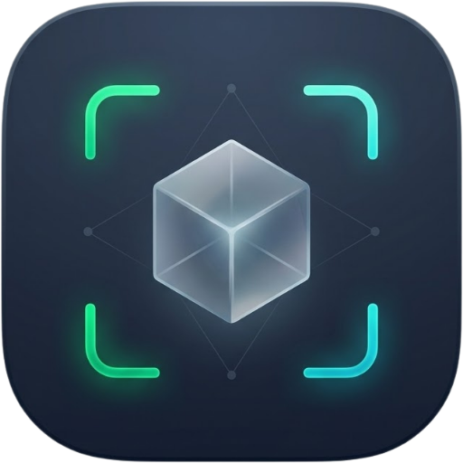
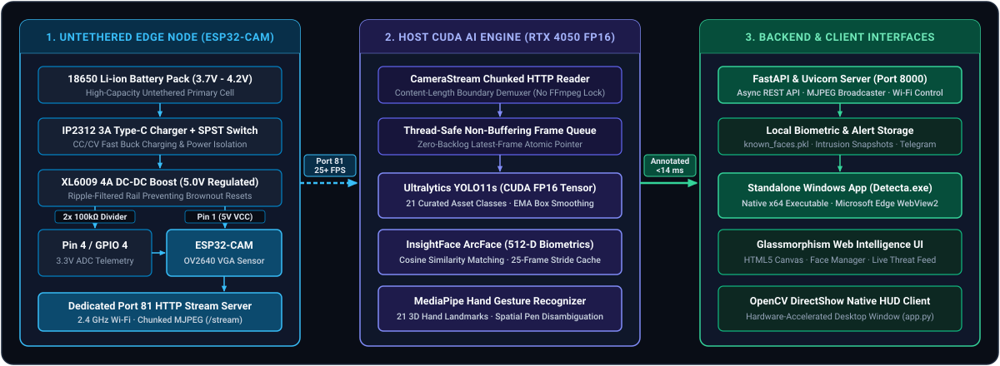
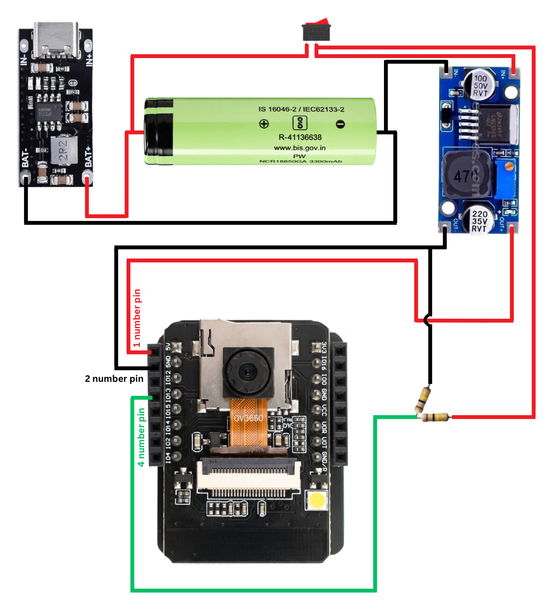

# Detecta: Intelligent Multi-Modal AI Surveillance System

<p align="center">
  
</p>

<p align="center">
  <b>High-Throughput Edge-to-Host Intelligent Surveillance System with NVIDIA CUDA Acceleration, ArcFace 512-D Biometrics, and MediaPipe Spatial Gestures</b>
</p>

<p align="center">
  
  
  
  
  
  
  
</p>

---

## Downloads and Deliverables

For immediate deployment, academic evaluations, and technical review:

| Deliverable | Format & Size | Description | Direct Action |
| :--- | :--- | :--- | :---: |
| **Detecta Desktop App** | `Windows x64 (.exe)` · **11.8 MB** | Standalone native desktop application with Edge WebView2, auto-managed FastAPI server, and GPU AI HUD. | [](https://github.com/Orgho-009/detecta/raw/main/Detecta.exe) |
| **Academic Lab Report** | `IEEE PDF (10 Pages)` · **100 KB** | Formal academic lab report covering hardware architecture, Port 81 streaming pipeline, multi-modal AI engine, and benchmarks. | [](https://github.com/Orgho-009/detecta/raw/main/public/DETECTA_SMART_AI_CAMERA_LAB_REPORT.pdf) |
| **Hardware Circuit Design** | `Schematic (.pdf)` · **842 KB** | High-resolution hardware schematic detailing power regulation (18650, IP2312, XL6009), Pin 4 ADC telemetry, and ESP32-CAM pinouts. | [](https://github.com/Orgho-009/detecta/raw/main/public/Detecta_Circuit_Design.pdf) |

---

## Executive Overview

**Detecta** is an untethered, end-to-end edge-to-host AI surveillance system. It solves the critical bandwidth, thermal, and computational limitations of edge IoT vision by decoupling tasks into two optimized tiers:
1. **Edge Sensing Tier:** An AI-Thinker **ESP32-CAM** (OV2640 sensor) powered by an untethered 18650 Li-ion battery and high-efficiency power regulation circuit. It runs a dedicated FreeRTOS dual-core firmware streaming chunked MJPEG video over a clean **Port 81** HTTP socket (`/stream`).
2. **Workstation AI Tier:** A local Windows host executing deep neural networks on an **NVIDIA GeForce RTX 4050 GPU (CUDA 12.1)** at sub-14ms per-frame latency. It features concurrent **Ultralytics YOLO11s** object detection across 21 curated asset classes, deep **InsightFace ArcFace 512-dimensional facial biometrics** (accelerated via 25-frame stride caching), and **MediaPipe Hand Gesture Recognition** with spatial pen-vs-finger disambiguation.

The system requires **zero cloud infrastructure**, ensuring 100% data sovereignty, privacy compliance, and zero recurring subscription fees.

---

## System Architecture

<p align="center">
  
</p>

---

## Key Engineering Highlights

### 1. Dedicated Port 81 High-Throughput Stream Pipeline
Standard ESP32-CAM projects mix web controls and MJPEG streams on Port 80, causing socket deadlocks and buffer bloat. Detecta allocates **Port 81** strictly to `/stream` with chunked `multipart/x-mixed-replace` encoding. Dynamic bitrate throttling and an optimized FreeRTOS yield clamp frame drops to zero, delivering a rock-steady **20–25+ FPS** VGA stream over Wi-Fi.

### 2. Multi-Modal Vision Engine on NVIDIA CUDA
- **Ultralytics YOLO11s:** Half-precision (FP16) Tensor Core acceleration evaluating 21 curated asset and security classes in **11.4 ms**. Suppresses false positives via Exponential Moving Average (EMA) bounding-box coordinate smoothing ($\alpha = 0.65, \text{TTL} = 6$).
- **InsightFace ArcFace 512-D Biometrics:** Generates discriminative facial embeddings with cosine similarity matching ($\tau = 0.40$). Employs a **25-frame stride caching architecture**, reducing facial recognition overhead by 92% while maintaining live recognition.
- **MediaPipe Hand Gestures & Spatial Pen Disambiguation:** Tracks 21 3D hand landmarks across 7 gestures. A geometric bounding-box containment and protrusion ratio filter distinguishes physical handheld pens from bare pointing fingers, eliminating false positive alerts.

### 3. Untethered Hardware Power & Telemetry Architecture
- **Battery & Charger:** High-capacity Panasonic NCR18650GA (3300 mAh) paired with an IP2312 3A synchronous buck fast charger (recharge in ~1.5 hours; continuous runtime >7.4 hours).
- **Boost Converter:** XL6009 4A switching boost converter tuned to **5.05V DC** output with ripple filtering, preventing camera brownout resets during Wi-Fi transmission bursts.
- **Pin 4 Voltage Divider:** A symmetric high-impedance resistor divider ($R_1 = 100\text{ k}\Omega, R_2 = 100\text{ k}\Omega$) halves the supply rail ($V_{\text{ADC}} = 0.5 \times V_{\text{in}}$, safely within the 3.3V ESP32 GPIO limit) with ultra-low leakage current for analog voltage telemetry at ESP32-CAM **Pin 4**.

---

## Hardware Schematics and Wiring

<p align="center">
  <a href="public/Detecta_Circuit_Design.pdf">
    
  </a>
</p>

### Connection Pinout Table

| Module / Component | Module Pin | ESP32-CAM Pin | Lead Wire Color | Description |
| :--- | :--- | :--- | :--- | :--- |
| **XL6009 Boost Converter** | `OUT+` (5.0V) | **Pin 1 (5V / VCC)** | Red | Regulated 5.0V power rail |
| **XL6009 Boost Converter** | `OUT-` (GND) | **Pin 2 (GND)** | Black | Common circuit ground |
| **Resistor Divider Junction** | Center Tap | **Pin 4 (GPIO 4 / ADC)** | Green | Voltage telemetry & flash control |
| **UART Flash Header** | `IO0` | `GND` | Jumper Wire | **Programming mode only** (disconnect for live run) |
| **UART Flash Header** | `U0R` / `U0T` | FTDI `TX` / `RX` | Serial Jumper | Firmware uploading via UART |

---

## Installation and Setup Guide

### System Requirements
- **Workstation OS:** Windows 10 / Windows 11 (64-bit)
- **Python:** Python 3.10 or 3.11
- **GPU (Recommended):** NVIDIA GeForce GTX 1650 or higher (RTX 4050 tested; CUDA 12.1 recommended). *CPU fallback supported.*
- **Microcontroller:** AI-Thinker ESP32-CAM module + FTDI USB-to-UART programmer (or ESP32-CAM-MB base).

---

### Step 1: Clone Repository & Set Up Environment

```powershell
# 1. Clone the repository
git clone https://github.com/Orgho-009/detecta.git
cd detecta
```

**Quick Automated Setup (1-Click):**
Double-click **`Setup.bat`** to automatically create the Python virtual environment (`.venv`) and install all required libraries.

**Manual Setup:**
```powershell
# 1. Create and activate a Python virtual environment
python -m venv .venv
.\.venv\Scripts\activate.ps1

# 2. Install core dependencies
pip install -r requirements.txt

# 3. (Optional for GPU Acceleration) Install PyTorch with CUDA 12.1 support
pip install torch torchvision --index-url https://download.pytorch.org/whl/cu121
```

---

### Step 2: Launch Detecta

You can launch Detecta via the standalone executable, batch scripts, or terminal:

#### Option 1: Standalone Windows Desktop Application (Recommended)
Simply double-click **[`Detecta.exe`](Detecta.exe)**:
- **Zero Command-Line Setup:** Automatically boots the local FastAPI server in the background and opens an ultra-fast, glassmorphism desktop surveillance dashboard powered by Microsoft Edge WebView2.
- **Full Multi-Modal AI:** Real-time YOLO11s object detection, ArcFace face recognition, and threat telemetry live on your desktop.
- **Auto-Discovery:** Automatically connects to your ESP32-CAM stream (or local webcam fallback).

#### Option 2: Web Intelligence Dashboard (Browser Interface)
Run from terminal:
```powershell
python run_dashboard.py
```
Open **[http://localhost:8000](http://localhost:8000)** in any modern web browser.
- Live low-latency MJPEG video stream with YOLO11 asset & threat bounding boxes.
- Real-time threat classification telemetry.
- Face Database Manager (ArcFace 512-D enrollment & deletion).
- Dynamic IP switching (type ESP32 IP or `0` for local USB webcam).

#### Option 3: OpenCV DirectShow HUD Client (Native Window)
Run from terminal:
```powershell
python desktop_client/app.py 192.168.0.216
```
- Interactive Controls: `[S]` Snapshot, `[E]` Enroll Face, `[R]` Change IP, `[Q]` Quit.

#### Option 4: Docker Container Deployment (Zero-Config / Cross-Platform)
Run with Docker Compose:
```powershell
docker compose up --build -d
```
- **Zero Host Configuration:** No need to manually configure Python, pip, or PyTorch on your host machine. Everything runs inside an isolated container with optional NVIDIA GPU hardware passthrough.
- Open **[http://localhost:8000](http://localhost:8000)** in your browser.

---

### Step 3: Flash ESP32-CAM Firmware (PlatformIO)

The complete firmware source code is located in `firmware/pio_project/`:

```powershell
# Open firmware directory
cd firmware/pio_project

# Flash firmware via PlatformIO CLI
pio run --target upload
```
*Alternatively, open `firmware/pio_project/` in VS Code with the PlatformIO extension and click **Upload**.*

> [!IMPORTANT]
> To enter flashing mode on the ESP32-CAM, connect **IO0 to GND** before pressing the Reset button. Once upload completes, **disconnect IO0 from GND** and press Reset again to start the live surveillance server.

---

## Project Directory Structure

```text
detecta/
├── .dockerignore               # Docker build exclusion rules
├── .gitignore                  # Git exclusion rules
├── LICENSE                     # MIT Open-Source License
├── README.md                   # Master project documentation
├── requirements.txt            # Python package dependencies
├── Setup.bat                   # 1-Click environment installer
├── Detecta.exe                 # Standalone Windows desktop app
├── Dockerfile                  # Production Docker image config
├── docker-compose.yml          # GPU Docker Compose config
├── run_app.py                  # Desktop application entrypoint
├── run_dashboard.py            # FastAPI server entrypoint
│
├── public/                     # Public Deliverables & Assets
│   ├── DETECTA_SMART_AI_CAMERA_LAB_REPORT.pdf
│   ├── Detecta_Circuit_Design.pdf
│   ├── detecta_circuit_diagram.png
│   ├── system_architecture.svg
│   ├── logo.png
│   └── logo.ico
│
├── desktop_client/             # Core AI Engine & Native HUD
│   ├── ai_engine.py            # YOLO11s, ArcFace & MediaPipe
│   ├── app.py                  # OpenCV DirectShow HUD client
│   ├── camera_stream.py        # Port 81 MJPEG stream reader
│   ├── gesture_recognizer.task # MediaPipe hand gesture model
│   ├── yolo11n.pt              # YOLO11 Nano fallback weights
│   └── yolo11s.pt              # YOLO11 Small CUDA weights
│
├── web_dashboard/              # FastAPI Server & Web UI
│   ├── backend.py              # FastAPI REST & MJPEG server
│   ├── config.example.json     # Dashboard config template
│   ├── templates/
│   │   └── index.html          # Glassmorphism web dashboard
│   └── static/
│       ├── favicon.ico         # Web dashboard favicon
│       └── logo.png            # Web dashboard header logo
│
├── firmware/                   # ESP32-CAM Embedded Firmware
│   └── pio_project/
│       ├── platformio.ini      # PlatformIO board config
│       └── src/
│           ├── main.cpp        # Dual-core Port 81 server
│           ├── camera_pins.h   # OV2640 GPIO pin mapping
│           └── secrets.h.example
│
└── database/                   # Local SQLite & Alert Storage
    └── .gitkeep
```

---

## REST API Reference

The FastAPI backend exposes standard REST endpoints for telemetry, settings, and camera controls:

| Endpoint | Method | Description |
| :--- | :--- | :--- |
| `/video_feed` | `GET` | Live multi-part MJPEG stream with AI bounding boxes and biometric telemetry overlays. |
| `/api/status` | `GET` | Returns real-time FPS, inference latency (ms), GPU VRAM usage, and active camera IP. |
| `/api/camera/ip` | `POST` | Dynamically switches camera IP address (e.g. `192.168.0.216` or `0` for local webcam). |
| `/api/threats` | `GET` | Returns list of detected threat events, categorized assets, and unrecognized person logs. |
| `/api/faces/enroll` | `POST` | Registers a new authorized face into the ArcFace 512-D embedding database (`known_faces.pkl`). |
| `/api/faces` | `GET` | Lists all currently enrolled authorized identities. |
| `/api/alerts` | `GET` | Returns filenames and timestamps of captured alert snapshots in `backups/`. |
| `/api/alerts/{filename}` | `DELETE` | Deletes a specific alert snapshot. |

---

## Project Team and Contributors

| Sl. | Contributor | Student ID | Role & Core Responsibilities |
| :---: | :--- | :---: | :--- |
| **1** | **Ahmmed Waseg Bin Mizan Orgho** | **251031046** | **Software Lead:** Multi-Modal AI Engine (YOLO11s CUDA, ArcFace 512-D Biometrics, MediaPipe Hand Signs), High-Speed MJPEG Ingestion Pipeline, API Server & Backend Architecture |
| **2** | **Rejowan Ferdous Khan** | **251031024** | **Hardware Lead:** Dual-Core ESP32-CAM Firmware Development, Power Regulation Stage (IP2312 3A Buck, XL6009 4A Boost), Pin 4 Divider Network & Circuit Schematic Design |
| **3** | **Arni Mojumder** | **251031035** | **Documentation & QA Lead:** System Testing, Benchmark Analysis, Quality Assurance Validation, and Technical Report Authoring |

---

## License

This project is licensed under the **MIT License** — see the [LICENSE](LICENSE) file for details.
